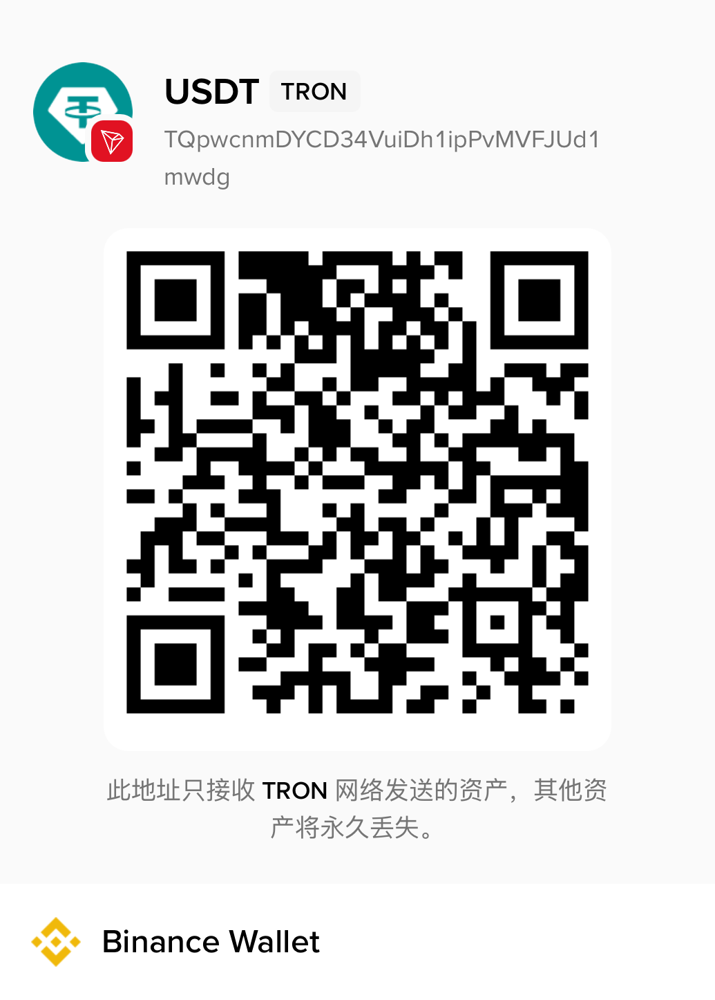

# ☕ Support this Project

If you find this project useful, you can support its development by making a donation.

Your support is greatly appreciated! ❤️

---

## USDT (TRON / TRC20)

Receiving address `TQpwcnmDYCD34VuiDh1ipPvMVFJUd1mwdg`

Send USDT over the TRON (TRC20) network.

---

## 🙏 Acknowledgments

Every bit of support motivates me to keep improving this project. Thank you for your generosity!

---

## 📝 Note

- Donations are completely voluntary and do not affect your ability to use any features of this project.
- If you have any questions or suggestions, please feel free to give feedback via [GitHub Issues](https://github.com/jlcodes99/cockpit-tools/issues).
