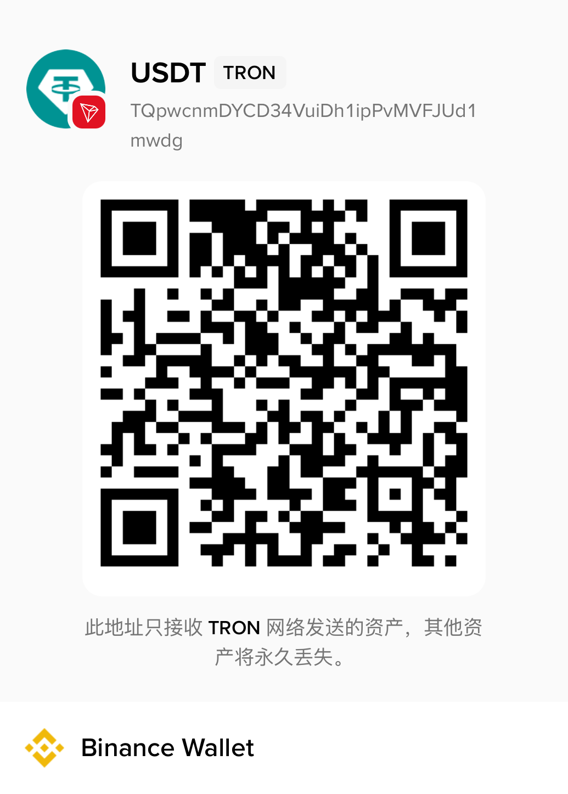

# ☕ 赞助支持

感谢您使用 **Cockpit Tools**！

如果这个项目对您有帮助，欢迎通过以下方式赞助项目的持续开发和维护：

---

## 💝 赞助方式

### 支付宝

### 微信支付

### USDT（TRON / TRC20）

收款地址 `TQpwcnmDYCD34VuiDh1ipPvMVFJUd1mwdg`

请通过 TRON（TRC20）网络发送 USDT。

---

## 🙏 致谢

您的每一份支持都是对开源项目最大的鼓励！

无论金额大小，都代表着您对这个项目的认可。感谢您的慷慨！

---

## 📝 说明

- 赞助完全自愿，不影响您使用本项目的任何功能
- 如有任何问题或建议，欢迎通过 [GitHub Issues](https://github.com/jlcodes99/cockpit-tools/issues) 反馈
