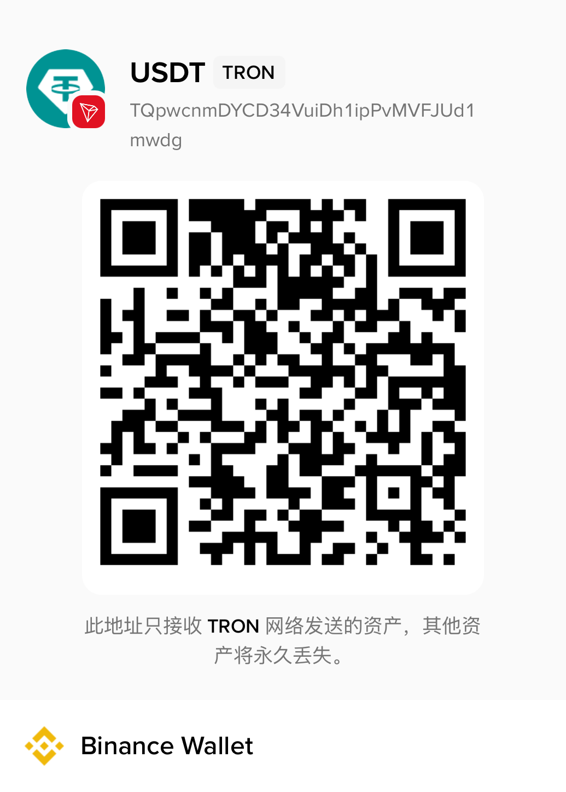

# ☕ Apoie este projeto

Se você achar este projeto útil, pode apoiar o seu desenvolvimento fazendo uma doação.

Seu apoio é muito apreciado! ❤️

---

## USDT (TRON / TRC20)

Endereço de recebimento `TQpwcnmDYCD34VuiDh1ipPvMVFJUd1mwdg`

Envie USDT pela rede TRON (TRC20).

---

## 🙏 Agradecimentos

Todo apoio me motiva a continuar aprimorando este projeto. Obrigado pela sua generosidade!

---

## 📝 Observação

- As doações são totalmente voluntárias e não afetam sua capacidade de usar nenhum recurso deste projeto.

- Se você tiver alguma dúvida ou sugestão, sinta-se à vontade para enviar seu feedback através de [GitHub Issues](https://github.com/jlcodes99/cockpit-tools/issues).

