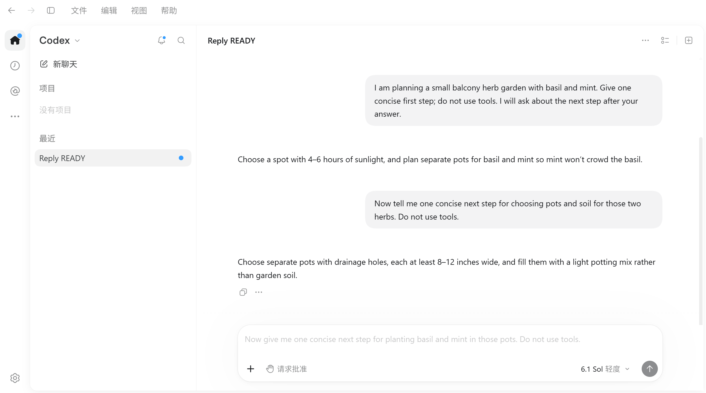
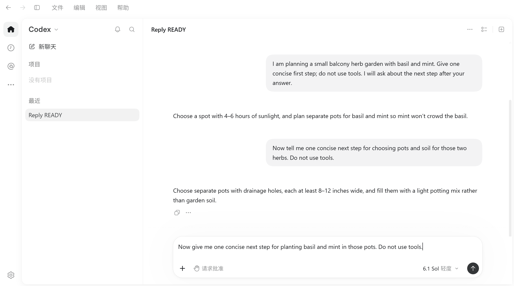

# Native composer predictions for local API connections

Cockpit can optionally connect a local API-backed Codex conversation to Codex's
native next-message prediction editor. Enable **Native next-step predictions
(Tab completion)** in the Codex enhancement settings, then restart the target
Codex instance through Cockpit. The option is disabled by default.

Predictions use the conversation's current model and provider. They make
additional API requests and consume that provider's usage allowance. A
prediction becomes an editable draft when accepted with Tab; it is not sent
automatically.

## Compatibility boundary

The adapter uses the existing Cockpit document-start module loader. It does not
rewrite Codex installation files, create an additional suggestion overlay, or
send model requests from an independent HTTP client. The Codex app-server owns
native `thread/sample` inference from the loaded source conversation; the existing Codex editor owns
the gray suggestion and Tab behavior. A small compatibility controller connects
those existing interfaces for verified local API connections. It is not a copy
of the official main-process prediction controller or its remote configuration.

The sampling method is also used by the official prediction controller. Cockpit
calls it through the app's existing renderer IPC; this does not convert that IPC
into the main process's private internal-request channel. Unlike the previous
renderer fork implementation, it creates no ordinary temporary conversation or
prediction turn for the renderer to treat as user work.

ChatGPT-authenticated, remote, SSH, and cloud connections retain their original
behavior. The original **Show predictions** preference is respected. Unknown
module layouts leave prediction compatibility disabled while preserving normal
chat and independently supported Cockpit enhancements.

## Request lifecycle

The source thread is resumed and its latest turn checked before calling
`thread/sample` with its `threadId` and `expectedTurnId`. The native sampler
inherits the source model, provider, and conversation context; the adapter does
not replay history or override the model/provider. A short prediction instruction asks
for JSON containing one `suggestion` string or `null` and explicitly forbids
acting on the source conversation or calling tools.

Requests are deduplicated by source turn, with one active prediction per thread,
a 45-second deadline, and no automatic retry. New turns, account/provider
changes, disabling the option, and runtime disposal cancel pending work. Late
results are discarded. The response must contain the matching `sourceTurnId`
and a real `responseId`; no prediction thread or turn IDs are fabricated.

Each sample owns its JSON-RPC ID. Cancellation releases local listeners and
ends the local request first, then abandons the queued IPC request and sends
`thread/sample/cancel` for that same ID. The existing 45-second wall-clock timer
is independent of IPC queue expiration. Network cancellation never blocks local
result delivery, and the source turn is never interrupted. An old task can
remove only its own active-job entry. Unsupported sampling does not fall back
to the previous renderer fork path.

The native `disableMcp` option applies where the inherited incremental-tool
window supports it; it is not a universal server-side tool prohibition. The
sampling response uses `text: null` when a tool call was attempted or no text
was produced, and an empty response is not published as a suggestion.

## Normal task notifications

Normal completion notifications and their user preferences are unchanged.
There is no notification filter, global mute, or replacement toast. Earlier
renderer prediction forks could enter the ordinary completion path and expose
their JSON as a notification; the sampling path avoids creating that ordinary
renderer conversation rather than suppressing its notification afterward.

## Verification and reports

Regression coverage belongs with the enhancement configuration tests, the
synthetic module-transform fixtures, the native module loader, and prediction
RPC lifecycle tests. Live acceptance must use a synthetic conversation and
actual Tab key input: a native gray suggestion must become an editable draft
without increasing the submitted message count. Draft protection, composition
input, navigation, cancellation, and disabled/unsupported configurations must
also be checked.

Compatibility reports should contain the Cockpit and Codex versions, the
adapter status/reason, and sanitized test results. Do not include credentials,
provider endpoints, real conversations, or copied official application modules.

### Sampling preflight

The installed app-server `0.164.0-alpha.11.1` was tested with the current API
model/provider in an isolated synthetic source. Sampling returned a valid
suggestion and matching source ID in about 5.4 seconds. The original request of
a second sample returned `sample canceled` after cancellation; an empty cancel
acknowledgement alone was not counted as proof. Source turns remained unchanged,
and sampling emitted no ordinary turn-start, turn-complete, or message-delta events.

In the unmodified official desktop app, a transparent test observer forwarded
the ordinary completion notification and received its real native `onShown`
callback. A successful renderer sampling request then produced no additional
notification calls or native callbacks during a dedicated 5.4-second window.
The observer did not discard calls, and its original host reference and the
isolated notification preference were restored after the test. These are
preflight results; corrected-adapter acceptance is recorded separately below.

### Corrected sampling adapter acceptance

The sampling acceptance used the unmodified official Windows package
`26.1021.3705.0` and app-server `0.164.0-alpha.11.1`. The older desktop version
below belongs to the initial implementation's historical acceptance.

The v2 adapter generated both catch-up and automatic live predictions through
the official sampler. Real `responseId` and matching source-turn metadata were
observed, and the native `cumberbatch` plugin displayed the suggestion. Actual
Tab acceptance inserted the exact editable draft without changing message
counts. Existing-draft, Chinese IME, and running-turn stale-suggestion checks
also passed.

With this adapter enabled, the ordinary synthetic task produced one forwarded
completion notification and one real native `onShown` callback. Its automatic
live prediction then succeeded without any additional notification calls or
native callbacks during a dedicated 5577.8 ms post-success window. The observer
forwarded every call and restored the original host reference afterward; no
notification filter or global mute was used.

An actual in-flight adapter request was also cancelled through the renderer
IPC path. The same request ID was observed at sample dispatch, enqueue ACK,
abandon, and `thread/sample/cancel`; the original sample returned
`-32603: sample canceled`, not merely a queued-request error or cancel ACK.
Source turns remained unchanged, and no source turn was interrupted.

The updated adapter/module graph suite passed 33 tests. The complete enhancement
CJS suite passed 136 tests, with 15 optional artifact checks skipped and no
failures. The standard Windows release build, including its required TypeScript
checks, also passed. Unrelated initial tests below were not additionally rerun.

The accepted Windows build was installed after a new complete backup of the
preceding build; the original pre-feature backup was retained. All 19 deployed
files matched the validated bundle. The complete Cockpit configuration was
semantically unchanged, predictions remained enabled, and the original Codex
process continued running. The installed official ASAR hash was unchanged.
Existing Codex documents load the sampling adapter after an idle instance
restart through Cockpit; installation did not restart those documents.

### Initial fork implementation acceptance (historical)

The adapter was exercised on Windows with Codex desktop `26.1021.31345`
(build `21828`) and an API-backed local synthetic conversation. The installed
official app files were not changed. That version produced a suggestion
through a native ephemeral prediction fork and the existing `cumberbatch`
editor plugin. Actual Tab key input changed the empty editor document into the
suggested editable draft; the submitted user/assistant message counts stayed
at three each. Separate checks preserved an unsent draft and Chinese IME
composition without accepting a prediction or sending a message.

| Native suggestion before Tab | Editable draft after Tab |
| --- | --- |
|  |  |

With the native **Show predictions** preference disabled, a subsequent
synthetic turn completed without starting a prediction. With it enabled, the
previous suggestion disappeared throughout the next active user turn.

The synthetic module/RPC tests cover unsupported and ambiguous contracts,
independent prediction-only activation, shared Fast/quota module graphs,
transport reattachment, native setting disablement, early/late notifications,
timeout, cancellation, approval requests, invalid fork identities, and cleanup.
The initial adapter and graph checks passed 26 tests. The full enhancement CJS
suite passed 129 tests with 15 optional installed-artifact checks skipped.
The shared settings UI passed both variants; all 18 locale files passed key
validation. Rust enhancement/lifecycle checks passed 67 tests, with the two
additional default/partial-update configuration checks also passing.

On this Windows machine the generated Rust library-test executable needed a
Common Controls v6 manifest to load `TaskDialogIndirect`. The manifest was
added only to that local build artifact before running the tests. The normal
Tauri application already contains the required manifest; no system DLL or
product dependency changes were made for the test harness.

The full TypeScript suite on a Chinese Windows locale had two pre-existing
compact-number formatting assertion failures (`4567` versus English `4.6K`,
and `4500` versus `4.5K`). Both were reproduced from the unmodified upstream
revision `2cfe5e51314bfc0bf70bdda1ba08aed82c7dc8bf`; prediction settings tests and
the TypeScript typecheck passed. This feature does not change number formatting.

The separate Electron native-module-loader smoke test also has a pre-existing
assertion mismatch on both this branch and that upstream revision: it expects
an unsupported quota module to fail, while the existing loader successfully
selects its Fast-only fallback. The test reaches that assertion in about four
seconds; an earlier 30-second startup timeout was not reproduced. This smoke
test is not counted as passing.

The Windows release build completed successfully. The local installation was
fully backed up before replacement; all 19 deployed files were verified, the
new option appeared enabled in the installed settings UI, and the only
configuration difference was the new prediction setting. The original Codex
process remained open and its installed ASAR hash was unchanged. Activating the
feature in an already open Codex document still requires restarting that
instance through Cockpit when idle.

### Cleanup timing follow-up (historical fork implementation)

A read-only comparison with the installed native prediction helper confirmed
that local listeners are released synchronously and server interrupt/unsubscribe
acknowledgements are not awaited before completing the request. The compatibility
adapter at that stage followed that order for successful, cancelled, and failed requests.
It also avoids interrupting an already terminal turn and compares existing job
promise identities so an old disposed task cannot remove a reacquired task for
the same source turn. No model, prompt, generation trigger, editor, or retry
policy changed.

Six additional deterministic regression tests cover deferred cleanup, rejected
cleanup, terminal failures, job reacquisition, and a synchronous manager error.
The updated adapter/module graph checks passed 32 tests; the complete enhancement
CJS suite passed 135 tests with the same 15 optional artifact checks skipped.
The unrelated initial configuration, locale, and Rust results above remain the
original acceptance results.

One paired synthetic measurement used the same official Codex version and
conversation, with temporary test-harness instrumentation only:

Gray timing records the native plugin's DOM insertion with `MutationObserver`;
it is not a physical screen-paint measurement.

| Interval | Before | After |
| --- | ---: | ---: |
| Prediction request to prediction turn completed | 6921.1 ms | 5199.0 ms |
| Turn completed to service result delivered | 38.4 ms | 21.4 ms |
| Turn completed to native gray rendered | 68.2 ms | 44.5 ms |
| Turn completed to unsubscribe acknowledged | 38.0 ms | 54.0 ms |
| Prediction request to native gray rendered | 6989.3 ms | 5243.5 ms |

After the fix, the native gray appeared 9.5 ms before unsubscribe completed.
This demonstrates that server cleanup no longer blocks result delivery. The
roughly 1.7-second difference in total duration mostly reflects prediction
generation variability; this single pair is not evidence of a stable
seconds-level speedup. Model/provider inference still takes additional time.

The corrected source was rechecked in the native UI: actual Tab acceptance kept
message counts unchanged, and draft, Chinese IME, and running-turn checks passed.
Only synthetic conversations and sanitized timing results were retained.

The corrected Windows release was rebuilt and installed after a separate full
backup of the preceding feature build. All 19 installed files matched the new
bundle; settings were unchanged and predictions remained enabled. The original
Codex process and installed ASAR were preserved. The first pre-feature backup
was also retained. An existing Codex document loads the correction after an
idle restart through Cockpit.
